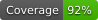

# Repository Coverage

[Full report](https://htmlpreview.github.io/?https://github.com/MartinPdeS/BornSim/blob/python-coverage-comment-action-data/htmlcov/index.html)

| Name                                   |    Stmts |     Miss |   Branch |   BrPart |      Cover |   Missing |
|--------------------------------------- | -------: | -------: | -------: | -------: | ---------: | --------: |
| bornsim/angular\_data.py               |      144 |       17 |       80 |       16 |     85.27% |73, 87, 136, 139, 142, 145, 188, 194, 210, 223, 226, 271, 294, 334, 337, 349, 464 |
| bornsim/convergence.py                 |       71 |       11 |       34 |        7 |     79.05% |40, 44, 46, 86-\>90, 88-\>90, 103, 106, 125-133 |
| bornsim/directions.py                  |       37 |        2 |       12 |        1 |     93.88% |  132, 149 |
| bornsim/ensemble.py                    |       65 |        3 |       16 |        4 |     91.36% |41, 64, 75, 155-\>158 |
| bornsim/ensemble\_sampling.py          |       44 |        3 |       22 |        3 |     90.91% |54, 61, 88 |
| bornsim/geometry.py                    |      163 |       11 |       42 |       11 |     89.27% |61, 108, 111, 160, 163, 281, 291, 399, 455, 458, 514 |
| bornsim/green.py                       |       39 |        1 |        4 |        1 |     95.35% |        84 |
| bornsim/grid.py                        |       55 |        4 |       22 |        3 |     90.91% |58, 64, 85, 134 |
| bornsim/material.py                    |       32 |        4 |       12 |        3 |     84.09% |52, 65, 96, 104 |
| bornsim/medium/\_\_init\_\_.py         |       13 |        7 |        4 |        0 |     35.29% |     14-24 |
| bornsim/medium/base.py                 |       17 |        4 |        0 |        0 |     76.47% |33, 83, 107, 131 |
| bornsim/medium/particles/spheres.py    |       64 |        2 |       26 |        2 |     95.56% |   59, 133 |
| bornsim/medium/random/fields.py        |       79 |        3 |       16 |        1 |     95.79% |40, 142, 182 |
| bornsim/medium/structured/composite.py |      160 |       18 |       80 |       12 |     86.67% |69, 72, 86, 146, 163, 166, 196, 306, 349, 412, 417-423, 427-432 |
| bornsim/medium/structured/periodic.py  |       44 |        3 |       12 |        3 |     89.29% |52, 55, 65 |
| bornsim/plotting.py                    |      165 |       16 |       76 |       14 |     86.72% |24, 86, 209, 212, 265, 271, 277, 280, 293, 304, 332, 381-386, 455, 465-\>468 |
| bornsim/results.py                     |      237 |       26 |      110 |       22 |     86.17% |153, 158, 161, 214, 255, 258, 272, 274, 278, 292, 295, 298, 307, 319, 328, 338, 570, 587, 608, 614-620, 727, 730, 733, 751 |
| bornsim/rotation.py                    |       40 |        2 |       10 |        2 |     92.00% |    57, 60 |
| bornsim/sampling.py                    |       83 |        4 |       20 |        1 |     95.15% |171-175, 370 |
| bornsim/series.py                      |       94 |        2 |       24 |        2 |     96.61% |  104, 298 |
| bornsim/solver.py                      |       75 |        7 |       24 |        5 |     87.88% |39, 42, 45-47, 144, 169, 344 |
| bornsim/source.py                      |       61 |        1 |       22 |        1 |     97.59% |       157 |
| bornsim/volume.py                      |      180 |        5 |       64 |        5 |     95.90% |59, 79, 89, 99, 504 |
| **TOTAL**                              | **2121** |  **156** |  **746** |  **119** | **89.99%** |           |

12 files skipped due to complete coverage.

## Setup coverage badge

Below are examples of the badges you can use in your main branch `README` file.

### Direct image

This is the one to use if your repository is private or if you don't want to customize anything.

### [Shields.io](https://shields.io) Json Endpoint

Using this one will allow you to [customize](https://shields.io/endpoint) the look of your badge.
It won't work with private repositories. It won't be refreshed more than once per five minutes.

### [Shields.io](https://shields.io) Dynamic Badge

This one will always be the same color. It won't work for private repos. I'm not even sure why we included it.

## What is that?

This branch is part of the
[python-coverage-comment-action](https://github.com/marketplace/actions/python-coverage-comment)
GitHub Action. All the files in this branch are automatically generated and may be
overwritten at any moment.