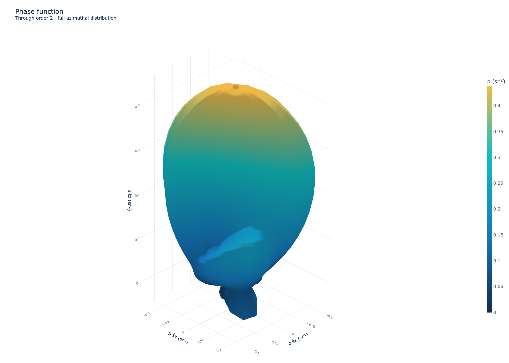
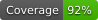

BornSim
========

.. list-table::
   :width: 100%
   :widths: 35 65
   :header-rows: 1

   * - Badge
     - Status
   * - Python versions
     - |mps-python|
   * - Documentation
     - |mps-docs|
   * - Tests
     - |mps-ci| |mps-coverage|
   * - PyPI
     - |mps-pypi| |mps-downloads|
   * - Conda
     - |mps-conda| |mps-conda-downloads| |mps-conda-release|

Vector Born-series scattering from continuous random dielectric media

Construct a refractive-index volume and calculate its vector scattering field order
by order. Compare successive Born terms and check the integral-equation residual
before interpreting the angular distribution.

See the `usage guide <https://github.com/MartinPdeS/BornSim/blob/HEAD/USAGE.rst>`__ for further examples and implementation details.

   Directional scattering phase density from a seeded refractive-index volume.

Installation
------------

Requires Python ``>=3.11``.

.. code-block:: console

   $ python -m pip install BornSim

Install from the ``martinpdes`` Conda channel:

.. code-block:: console

   $ conda install -c martinpdes bornsim

For an editable source installation:

.. code-block:: console

   $ git clone https://github.com/MartinPdeS/BornSim.git
   $ cd BornSim
   $ python -m pip install -e .

Normalize a phase function
--------------------------

.. code-block:: python

   """
   Phase density and polar-angle probability
   =========================================

   A phase function is a density per steradian. After explicit azimuth averaging,
   2*pi*p(theta)*sin(theta) is the polar-angle probability density per radian.
   Full solid-angle sampling supplies normalization separately at each Born order.
   An angular cut alone cannot provide this normalization.
   """

   # sphinx_gallery_thumbnail_path = "_static/gallery_thumbnails/phase_normalization.png"

   import matplotlib.pyplot as plt
   import numpy as np

   from bornsim import Grid, Solver, Source, Sphere, StructuredMedium
   from bornsim.units import ureg

   grid = Grid(
       shape=(12, 12, 12),
       spacing=20 * ureg.nanometer,
   )

   sphere = Sphere(
       radius=70 * ureg.nanometer,
       refractive_index=1.35,
   )

   medium = StructuredMedium()

   medium.add_background(refractive_index=1.33)

   medium.add_structures(sphere)

   volume = medium.to_volume(grid=grid)

   volume_figure = volume.plot_3d(
       field="refractive_index",
   )

   # %%
   source = Source(wavelength=633 * ureg.nanometer)

   solver = Solver(
       source=source,
       order=3,
   )

   result = solver.solve(target=volume)

   averaged = result.azimuth_average()

   theta = averaged.angles.to("radian").magnitude

   phase_density = averaged.phase_function.to("1 / steradian").magnitude

   figure, axes = plt.subplots(1, 2, figsize=(10, 4), layout="constrained")

   for order in (1, 2, 3):
       polar_density = 2 * np.pi * phase_density[order - 1] * np.sin(theta)

       axes[0].plot(theta, phase_density[order - 1], label=f"Order {order}")

       axes[1].plot(theta, polar_density, label=f"Order {order}")

   axes[0].set(ylabel="Phase density (sr⁻¹)")

   axes[1].set(ylabel="Polar-angle density (rad⁻¹)")

   for axis in axes:
       axis.set(xlabel="Polar angle (radians)")

       axis.legend()

   plt.show()

Documentation
-------------

Use the `BornSim documentation <https://martinpdes.github.io/BornSim/docs/latest/>`__ to work through
examples and look up the inputs and return values of individual functions.

Contributing
------------

Bug reports, worked examples, and documentation corrections are welcome.
To set up a development checkout and run the tests, follow the `contributing guide <https://github.com/MartinPdeS/BornSim/blob/HEAD/CONTRIBUTING.md>`__.

Contact
-------

For questions, contact `Martin Poinsinet de Sivry-Houle <mailto:martin.poinsinet.de.sivry@gmail.com?subject=BornSim>`__.

License
-------

BornSim is licensed under `MIT <https://github.com/MartinPdeS/BornSim/blob/HEAD/LICENSE>`__.

.. |mps-python| image:: https://img.shields.io/pypi/pyversions/bornsim.svg
   :alt: Supported Python versions
   :target: https://pypi.org/project/bornsim/

.. |mps-pypi| image:: https://img.shields.io/pypi/v/bornsim.svg
   :alt: PyPI version
   :target: https://pypi.org/project/bornsim/

.. |mps-downloads| image:: https://img.shields.io/pypi/dm/bornsim.svg
   :alt: Monthly PyPI downloads
   :target: https://pypistats.org/packages/bornsim

.. |mps-docs| image:: https://github.com/MartinPdeS/BornSim/actions/workflows/deploy_documentation.yml/badge.svg
   :alt: Documentation
   :target: https://martinpdes.github.io/BornSim/docs/latest/

.. |mps-ci| image:: https://github.com/MartinPdeS/BornSim/actions/workflows/tests.yml/badge.svg
   :alt: Tests
   :target: https://github.com/MartinPdeS/BornSim/actions/workflows/tests.yml

.. |mps-conda| image:: https://anaconda.org/martinpdes/bornsim/badges/version.svg
   :alt: Anaconda version
   :target: https://anaconda.org/martinpdes/bornsim

.. |mps-conda-downloads| image:: https://anaconda.org/martinpdes/bornsim/badges/downloads.svg
   :alt: Anaconda downloads
   :target: https://anaconda.org/martinpdes/bornsim

.. |mps-conda-release| image:: https://anaconda.org/martinpdes/bornsim/badges/latest_release_relative_date.svg
   :alt: Latest Anaconda release
   :target: https://anaconda.org/martinpdes/bornsim
