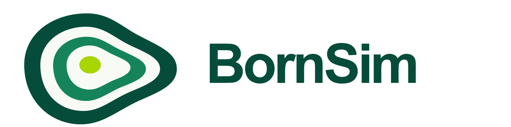

BornSim
=======

**Vector Born-series scattering from continuous, isotropic random media.**

.. list-table::
   :widths: 50 50
   :width: 100%
   :header-rows: 0
   :class: badge-table

   * - Python
     - |python|
   * - Documentation
     - |docs|
   * - Tests
     - |tests|
   * - Quality
     - |quality|
   * - Coverage
     - |coverage|
   * - Release
     - |release|
   * - License
     - |license|

BornSim models how light scatters from three-dimensional refractive-index
fluctuations. Build a random or structured medium, solve its coherent Born
series, and inspect angular scattering, phase functions, :math:`\mu_s`,
anisotropy :math:`g`, and reduced scattering :math:`\mu_s'`.

.. list-table::
   :widths: 50 50
   :class: image-table

   * - **3D medium opacity**
     - **3D SPF surface**
   * - .. image:: docs/images/bornsim_medium_opacity_3d.png
          :alt: Three-dimensional random medium rendered with increasing opacity
          :width: 100%
     - .. image:: docs/images/bornsim_spf_surface_3d.png
          :alt: Three-dimensional scattering phase-function surface
          :width: 100%

The left view shows the simulated refractive-index volume; opacity is a visual
encoding, not absorption. The right view shows the normalized scattering phase
function in direction space. Both figures are generated from the same
BornSim-style workflow below.

Quick start
-----------

.. code-block:: python

   from bornsim import EnsembleSampling, Grid, Solver, Source
   from bornsim.medium.random_medium import GaussianMedium
   from bornsim.units import ureg

   grid = Grid(shape=(16, 16, 16), spacing=50 * ureg.nanometer)
   medium = GaussianMedium(
       background_refractive_index=1.33,
       refractive_index_std=0.01,
       correlation_length=100 * ureg.nanometer,
   )

   solver = Solver(
       source=Source(wavelength=633 * ureg.nanometer),
       order=3,
   )

   result = solver.ensemble(
       medium=medium,
       grid=grid,
       ensemble_sampling=EnsembleSampling(realizations=4, seed=42),
   )

   print(result.mu_s.to("1 / millimeter"))
   print(result.g)
   print(result.mu_s_prime.to("1 / millimeter"))
   result.plot()

For one fixed structured sample, use ``solver.solve(target=volume)``. The
result can also be visualized directly:

.. code-block:: python

   volume = medium.to_volume(grid=grid, seed=42)
   medium_figure = volume.plot_3d(
       field="refractive_index",
       opacity_scale="increasing",
   )
   phase_figure = solver.solve(target=volume).plot_phase_function(view="3d")
   medium_figure.write_html("medium.html", include_plotlyjs=True)
   phase_figure.write_html("phase_function.html", include_plotlyjs=True)

What BornSim models
-------------------

* **Media:** Gaussian, exponential, and Whittle–Matérn random fields, seeded
  random spheres, and composable structured geometry.
* **Numerics:** vector volume-integral propagation with configurable Born order,
  angular quadrature, grid spacing, and ensemble sampling.
* **Results:** differential scattering, full directional phase functions,
  cross sections, uncertainty estimates, saved provenance, and Matplotlib or
  Plotly visualizations.
* **Reliability:** integral-equation residuals, explicit refinement reports,
  and weak-contrast absorbing-sphere validation against Mie theory.
* **Absorption and ensembles:** passive absorbing materials and random fields,
  absorption uncertainty, and coherent/diffuse scattering decomposition.
* **Units:** explicit physical units for wavelengths, lengths, angles, and
  scattering coefficients through ``bornsim.units.ureg``.

Installation
------------

BornSim requires Python 3.11 or newer.

.. code-block:: console

   $ python -m pip install BornSim

For development:

.. code-block:: console

   $ git clone https://github.com/MartinPdeS/BornSim.git
   $ cd BornSim
   $ python -m pip install -e ".[testing,documentation]"
   $ python -m pytest tests

Learn more
----------

* `Documentation <https://martinpdes.github.io/BornSim/docs/latest/>`_ —
  theory, API reference, numerical conventions, and visualization guidance.
* `Examples <https://martinpdes.github.io/BornSim/gallery/index.html>`_ —
  random media, structured samples, Born orders, validation, and result plots.
* `Medium visualization guide <https://martinpdes.github.io/BornSim/docs/latest/medium_visualization.html>`_ —
  interactive 3D volume and phase-function views.
* `Repository <https://github.com/MartinPdeS/BornSim>`_ — issues and
  contributions.

Scientific scope
----------------

BornSim uses the linearized dielectric contrast
:math:`\delta\varepsilon \approx 2 n_0 \delta n`. Its coefficients describe
finite numerical samples and are not automatically intrinsic infinite-medium
transport coefficients. Check grid, angular, sample-size, synthesis-box, and
ensemble convergence before interpreting results quantitatively.

License
-------

BornSim is released under the MIT License. See `LICENSE <https://github.com/MartinPdeS/BornSim/blob/master/LICENSE>`_.

.. |python| image:: https://img.shields.io/badge/Python-3.11%2B-3776AB.svg
   :alt: Python 3.11 or newer
   :target: https://www.python.org/
.. |docs| image:: https://github.com/MartinPdeS/BornSim/actions/workflows/deploy_documentation.yml/badge.svg
   :alt: Documentation build status
   :target: https://martinpdes.github.io/BornSim/docs/latest/
.. |tests| image:: https://github.com/MartinPdeS/BornSim/actions/workflows/tests.yml/badge.svg
   :alt: Test status
   :target: https://github.com/MartinPdeS/BornSim/actions/workflows/tests.yml
.. |quality| image:: https://github.com/MartinPdeS/BornSim/actions/workflows/quality.yml/badge.svg
   :alt: Static quality check status
   :target: https://github.com/MartinPdeS/BornSim/actions/workflows/quality.yml
.. |coverage| image:: https://raw.githubusercontent.com/MartinPdeS/BornSim/python-coverage-comment-action-data/badge.svg
   :alt: Test coverage
.. |release| image:: https://img.shields.io/github/v/tag/MartinPdeS/BornSim.svg
   :alt: Latest release tag
   :target: https://github.com/MartinPdeS/BornSim/tags
.. |license| image:: https://img.shields.io/github/license/MartinPdeS/BornSim.svg
   :alt: MIT license
   :target: https://github.com/MartinPdeS/BornSim/blob/master/LICENSE
