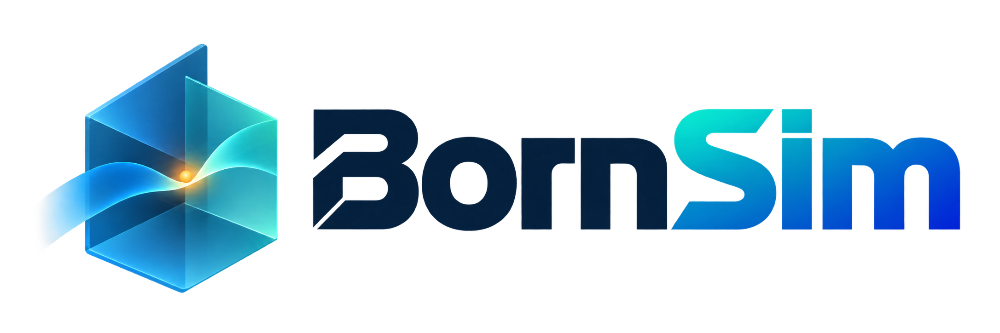

BornSim
=======

**Simulate how light scatters through three-dimensional refractive media.**

|python| |release| |license| |tests| |docs|

BornSim is a Python toolkit for finite-volume, vector Born-series calculations.
Build random or structured samples, calculate their scattering response, and
inspect results with BornSim's interactive Plotly 3D plotting methods.

.. list-table:: A sample and its calculated directional scattering
   :widths: 50 50
   :width: 100%
   :header-rows: 0
   :class: image-table

   * - .. image:: docs/images/bornsim_medium_isosurfaces_3d.png
          :alt: Plotly isosurfaces of a seeded three-dimensional refractive-index sample.
          :width: 100%
     - .. image:: docs/images/bornsim_phase_function_3d.png
          :alt: Directional phase-function density rendered radially on a three-dimensional surface.
          :width: 100%
   * - **Real-space medium**
       Plotly isosurfaces show the refractive-index field in physical coordinates.
     - **Angular scattering**
       Surface radius and color show the phase density in each observation direction.

These figures are static exports of BornSim's own Plotly figures, generated
from a seeded calculation. Regenerate them with
``docs/images/generate_readme_plots.py``. Static image export requires
Kaleido; the checked-in figures were generated with Kaleido 0.2.1. Volume
opacity is a display setting, not a measure of material absorption.

What you can model
------------------

* Gaussian, exponential, and Whittle–Matérn random fields.
* Seeded random sphere collections and structured particle geometries.
* Arbitrary incident directions and linear, circular, elliptical, or
  unpolarized illumination.
* Finite-volume vector scattering through configurable Born order.
* Directional phase functions, differential scattering, cross sections,
  anisotropy, absorption, ensemble uncertainty, and saved provenance.
* Grid, angular, ensemble, and integral-equation residual diagnostics.

Quick start
-----------

Install BornSim and run a seeded calculation:

.. code-block:: console

   $ python -m pip install BornSim

.. code-block:: python

   from bornsim import AngularSampling, Grid, Solver, Source
   from bornsim.medium.random_medium import GaussianMedium
   from bornsim.units import ureg

   grid = Grid(
       shape=(14, 14, 14),
       spacing=35 * ureg.nanometer,
   )

   medium = GaussianMedium(
       background_refractive_index=1.33,
       refractive_index_std=0.018,
       correlation_length=70 * ureg.nanometer,
   )

   volume = medium.to_volume(
       grid=grid,
       seed=42,
   )

   source = Source(
       wavelength=532 * ureg.nanometer,
   )

   sampling = AngularSampling(
       n_points=61,
       azimuth_samples=16,
   )

   solver = Solver(
       source=source,
       sampling=sampling,
       order=2,
   )

   result = solver.solve(
       target=volume,
   )

   print(f"Scattering coefficients: {result.mu_s.to('1 / millimeter')}")

   medium_figure = volume.plot_3d(
       field="refractive_index",
   )

   phase_figure = result.plot_phase_function(
       order=2,
   )

   medium_figure.show()

   phase_figure.show()

For random-medium statistics across independent realizations, use
``solver.ensemble(medium=..., grid=..., ensemble_sampling=...)``. For a fixed
geometry, compose shapes with ``StructuredMedium`` and pass its voxelized
volume to ``solver.solve``.

Plotting
--------

BornSim uses Matplotlib for 2D curves and voxel slices. Three-dimensional
views use Plotly exclusively; phase functions default to a directional 3D
surface. Rotate, zoom, and hover to inspect values. Plotly figures open no
window during construction and can be saved as self-contained HTML:

.. code-block:: python

   phase_figure.write_html(
       file="phase-function.html",
       include_plotlyjs=True,
   )

Use ``result.plot()`` for a Matplotlib curve of differential scattering, or
``result.plot_phase_function()`` for its default directional 3D phase surface.
Choose ``view="angular"`` or ``view="polar"`` for 2D Matplotlib phase views.
Use ``volume.plot_slice()`` to inspect exact voxel values in a 2D Matplotlib
slice. The 3D volume rendering interpolates between voxel centres, so use
slices and grid refinement when examining interfaces.

Model and interpretation
------------------------

BornSim solves a finite-sample volume-integral model with the linearized
dielectric contrast
:math:`\delta\varepsilon \approx 2 n_0 \delta n`. It does not include the
quadratic :math:`\delta n^2` term. Decreasing successive field terms do not
prove convergence of the Born series.

Reported scattering coefficients are finite-sample cross sections divided by
the simulated voxel-box volume. They are not automatically intrinsic,
infinite-medium transport coefficients. Check grid, angular, sample-size,
synthesis-box, and ensemble convergence before quantitative interpretation.
Wavelengths, lengths, angles, and dimensional outputs carry explicit units;
refractive indices are plain numbers.

Learn more
----------

* `Documentation <https://martinpdes.github.io/BornSim/docs/latest/>`_ —
  theory, API reference, model conventions, and visualization guidance.
* `Examples <https://martinpdes.github.io/BornSim/gallery/index.html>`_ —
  runnable studies of random media, structures, ensembles, and Born orders.
* `Reliability guide <https://martinpdes.github.io/BornSim/docs/latest/reliability.html>`_ —
  numerical validation and convergence checks.
* `Source and issues <https://github.com/MartinPdeS/BornSim>`_ — code,
  questions, and contributions.

BornSim requires Python 3.11 or newer. For development, install the testing and
documentation extras with ``python -m pip install -e ".[testing,documentation]"``.

License
-------

BornSim is released under the MIT License. See `LICENSE <https://github.com/MartinPdeS/BornSim/blob/master/LICENSE>`_.

.. |python| image:: https://img.shields.io/badge/Python-3.11%2B-3776AB.svg
   :alt: Python 3.11 or newer
   :target: https://www.python.org/
.. |release| image:: https://img.shields.io/github/v/tag/MartinPdeS/BornSim.svg
   :alt: Latest release tag
   :target: https://github.com/MartinPdeS/BornSim/tags
.. |license| image:: https://img.shields.io/github/license/MartinPdeS/BornSim.svg
   :alt: MIT License
   :target: https://github.com/MartinPdeS/BornSim/blob/master/LICENSE
.. |tests| image:: https://github.com/MartinPdeS/BornSim/actions/workflows/tests.yml/badge.svg
   :alt: Test status
   :target: https://github.com/MartinPdeS/BornSim/actions/workflows/tests.yml
.. |docs| image:: https://github.com/MartinPdeS/BornSim/actions/workflows/deploy_documentation.yml/badge.svg
   :alt: Documentation build status
   :target: https://martinpdes.github.io/BornSim/docs/latest/
